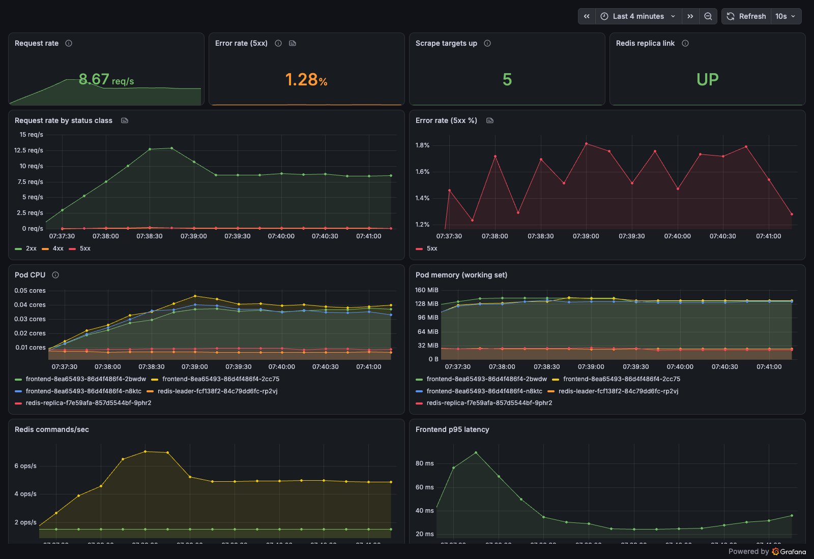

# Guestbook Monitoring (Pulumi + Prometheus + Grafana)

The Pulumi [`kubernetes-ts-guestbook`](https://github.com/pulumi/examples/tree/master/kubernetes-ts-guestbook)
example, extended with Prometheus and Grafana. One `pulumi up` deploys the
Guestbook, kube-prometheus-stack, ServiceMonitors for the frontend and the Redis
backend, and a Grafana dashboard with request rate, error rate, and pod
CPU/memory. Stack outputs give the Grafana URL and admin credentials.
`scripts/verify.sh` proves the whole thing end to end, and CI runs that same
proof on a throwaway k3d cluster for every push.

![Architecture: Pulumi, gated by a CrossGuard policy pack and a destroy guard, deploys to a k3d cluster. In the guestbook namespace, browser traffic enters each frontend pod through an Envoy sidecar that proxies to PHP/Apache, which writes to the Redis leader and reads from the replica. Each Redis pod runs a redis_exporter sidecar. In the monitoring namespace, ServiceMonitors point Prometheus at the Envoy and exporter metrics ports and at kubelet cAdvisor for pod CPU and memory, and Grafana, exposed on NodePort 30300 with a generated admin secret, reads from Prometheus.](docs/architecture.png)

*Every frontend request passes through an Envoy sidecar, which counts it by
status code; each Redis pod carries a redis_exporter sidecar. Prometheus finds
both through ServiceMonitors and takes pod CPU/memory from cAdvisor. Grafana is
the only monitoring component exposed outside the cluster.*

## Quick start

Requirements: Docker, [k3d](https://k3d.io), kubectl, Node 20+, the
[Pulumi CLI](https://www.pulumi.com/docs/iac/download-install/) (`brew install pulumi`), jq.
No Pulumi Cloud account is needed: state is kept in a local file backend
inside the repo (`.pulumi-state/`, gitignored).

```bash
scripts/deploy.sh    # creates k3d cluster "guestbook" if missing, then policy-gated preview, destroy-guard, pulumi up (about 2 minutes)
scripts/verify.sh    # end-to-end checks, see below
scripts/destroy.sh   # pulumi destroy + delete the cluster
```

`deploy.sh` encrypts the state with an empty passphrase by default so the demo
runs with no setup. Export `PULUMI_CONFIG_PASSPHRASE` first to use your own.

### Grafana URL and credentials

```bash
export PULUMI_BACKEND_URL="file://$(pwd)/.pulumi-state" PULUMI_CONFIG_PASSPHRASE=""
pulumi stack output grafanaUrl                       # http://localhost:30300
pulumi stack output grafanaUser                      # admin
pulumi stack output grafanaPassword --show-secrets   # generated, 24 chars
pulumi stack output grafanaDashboard                 # http://localhost:30300/d/guestbook-overview
pulumi stack output frontendUrl                      # http://localhost:30080
```

The password is generated by `random.RandomPassword`, stored in a Kubernetes
Secret, and handed to the chart as `grafana.admin.existingSecret`. It never
appears in Helm values and is a secret output in Pulumi state.

### Verifying that Prometheus scrapes the Guestbook

`scripts/verify.sh` does all of this and exits non-zero on any failure. Output
from a cold run (fresh cluster, `deploy.sh` then `verify.sh`):

```
==> Guestbook: write through the frontend, read back
  PASS  message 'verify-1793105683' stored and read back
  PASS  redis replica link to leader is up
  PASS  message replicated to the replica
==> Port-forwarding Prometheus on :9090
==> Prometheus scrape targets (waiting up to 3m: on a fresh cluster Prometheus is still loading its config)
        serviceMonitor/guestbook/guestbook-frontend-473baa4e/0 frontend-fe5614fa-5bd9f9ffc5-5zb65 up
        serviceMonitor/guestbook/guestbook-frontend-473baa4e/0 frontend-fe5614fa-5bd9f9ffc5-rfvcz up
        serviceMonitor/guestbook/guestbook-frontend-473baa4e/0 frontend-fe5614fa-5bd9f9ffc5-pndzf up
        serviceMonitor/guestbook/guestbook-redis-682447e9/0 redis-replica-33d4b0c8-857d5544bf-bxktj up
        serviceMonitor/guestbook/guestbook-redis-682447e9/0 redis-leader-c5cc1e50-84c79dd6fc-zjz9t up
  PASS  frontend (Envoy) targets up
  PASS  redis exporter targets up
  PASS  5/5 Guestbook targets healthy (3 frontend, leader, replica)
==> Generating traffic for ~40s: normal requests, forced 503s (Envoy fault header), 404s
==> Waiting one scrape interval so the last traffic lands, then querying
  PASS  frontend requests (total) = 212
  PASS  frontend request rate req/s (1m) = 4.3393945790677115
  PASS  frontend 5xx responses = 18
  PASS  frontend 4xx responses = 9
  PASS  redis commands processed = 469
  PASS  redis replica link up = 1
  PASS  pod CPU cores (cAdvisor) = 0.11111083046129946
  PASS  pod memory bytes (cAdvisor) = 374636544
==> Grafana at http://localhost:30300
  PASS  login as admin with the stack-output password
  PASS  dashboard 'Guestbook Overview' provisioned at http://localhost:30300/d/guestbook-overview
verify: all checks passed
```

To check by hand:

1. `kubectl -n monitoring port-forward svc/kps-prometheus 9090:9090`, then open
   <http://localhost:9090/targets> and filter on `guestbook`. You should see
   `serviceMonitor/guestbook/guestbook-frontend-*` (3 targets) and
   `serviceMonitor/guestbook/guestbook-redis-*` (2 targets), all UP.
2. Send some traffic: `for i in $(seq 50); do curl -s -o /dev/null "localhost:30080/guestbook.php?cmd=get&key=messages"; done`
3. Run these in the Prometheus graph tab:

| What | PromQL |
| --- | --- |
| Frontend request rate | `sum(rate(envoy_http_downstream_rq_total{envoy_http_conn_manager_prefix="ingress_http",namespace="guestbook"}[1m]))` |
| Requests by status class | `sum by (envoy_response_code_class) (rate(envoy_http_downstream_rq_xx{envoy_http_conn_manager_prefix="ingress_http",namespace="guestbook"}[1m]))` |
| Redis commands/sec | `sum by (pod) (rate(redis_commands_processed_total{namespace="guestbook"}[1m]))` |
| Pod CPU | `sum by (pod) (rate(container_cpu_usage_seconds_total{namespace="guestbook",container!=""}[2m]))` |
| Pod memory | `sum by (pod) (container_memory_working_set_bytes{namespace="guestbook",container!=""})` |

4. Force some errors to watch the error-rate panel move:
   `curl -H 'x-envoy-fault-abort-request: 503' localhost:30080/`. Envoy answers
   503 for requests carrying that header and leaves everything else alone.

### The dashboard



*Guestbook Overview under a steady load of about 9 req/s, with roughly 1 request
in 30 forced to 503 through the fault header above (hence the ~1.3% error
rate). Provisioned from `dashboards/guestbook.json` through the Grafana
dashboard sidecar.*

Panels: request rate, 5xx error rate, healthy scrape targets, Redis replica
link status, requests by status class, error rate over time, pod CPU,
pod memory, Redis commands/sec, frontend p95 latency. The default
kube-prometheus-stack dashboards (cluster, node, pod) are provisioned too.

## The problem

The upstream Guestbook has no observability. Neither the PHP/Apache frontend
nor Redis exposes a metrics endpoint, so "Prometheus scrapes the frontend and
backend" first needs something to scrape, and the error-rate panel needs
requests broken down by status code, which the frontend cannot produce. The
exercise also wants this deployed as code, with the Grafana address and
credentials coming out of the stack instead of a README.

## Key decisions

Full reasoning in [docs/adr/](docs/adr/).

- **Envoy sidecar for frontend metrics** ([ADR-0001](docs/adr/0001-envoy-sidecar-for-frontend-metrics.md)).
  Envoy counts every request by status class and latency with no change to the
  PHP app. Rejected: apache_exporter via mod_status, which reports totals only,
  so a real error rate is impossible. The Envoy admin API stays on localhost;
  a separate listener serves only `/stats/prometheus`.
- **redis_exporter sidecars on leader and replica.** Standard exporter, gives
  command rates, memory, and the replica's link status to the leader (the
  dashboard's replication health check).
- **kube-prometheus-stack through a Pulumi Helm Release** ([ADR-0002](docs/adr/0002-kube-prometheus-stack-via-helm-release.md)).
  Operator, ServiceMonitor CRD, cAdvisor scraping and Grafana provisioning in one
  pinned chart. Rejected: raw Deployments (annotation scraping, hand-written RBAC)
  and `helm.v4.Chart` (hundreds of objects in state for no benefit here).
- **ServiceMonitors over annotations.** Explicit, namespaced, and checked into
  the program. Metrics ports live on their own ClusterIP Services so the public
  NodePort Service exposes port 80 only.
- **NodePort by default, LoadBalancer behind a flag** ([ADR-0003](docs/adr/0003-nodeport-on-k3d.md)).
  k3d has no cloud load balancer. `pulumi config set useLoadBalancer true`
  switches both the frontend and Grafana, and the outputs follow.
- **Generated Grafana password as a Secret.** Rejected: `grafana.adminPassword`
  in values, which puts the password in the Helm release and the chart's
  rendered manifests. A policy rule now blocks that.

## What broke along the way

- **The upstream example's Redis replication is broken today.** It runs an
  unpinned `redis` leader against `pulumi/guestbook-redis-replica`, which is
  built on Redis 6.0.5. `redis:latest` is now 8.x, and the replica fails every
  sync with `Can't handle RDB format version 15`. Writes go to the leader and
  succeed, but reads go to the replica, which has no data, so the guestbook
  shows an empty list. The leader still reports `connected_slaves:1` while every
  sync fails, so a check on the leader would have passed. The dashboard and
  `verify.sh` read `master_link_status` from the replica instead, and verify
  reads the test message back from the replica itself. Fixed by running both
  tiers on the same pinned `redis:7.4.6` (the replica is
  `--replicaof redis-leader 6379`, which is all the old image's run.sh did).
  The `pinned-images` policy rule exists because of this.
- **The upstream images are amd64 only.** On an Apple Silicon laptop they run
  under emulation inside k3d. That works, but it is why the frontend image is
  pinned by digest rather than replaced.
- **k3s control plane targets.** kube-prometheus-stack ships scrape jobs for the
  controller manager, scheduler, etcd and kube-proxy. k3s runs those inside one
  binary, so the targets sit DOWN forever and fire alerts. They are disabled in
  the chart values.
- **Editing the dashboard made it disappear.** Pulumi replaces a ConfigMap when
  its data changes, creating the new one before deleting the old. Both map to
  `guestbook.json` in the Grafana sidecar, so the sidecar wrote the new file and
  then removed it when the old ConfigMap went away. The dashboard was gone until
  the sidecar's next resync, about 50 seconds later. The sidecar log showed
  write, write, remove. The dashboard ConfigMap now uses `deleteBeforeReplace`,
  and the log shows remove, then write.
- **verify.sh passed on a warm cluster and failed on a cold one.** Two causes.
  Right after a fresh deploy, Prometheus takes over a minute to load the
  ServiceMonitor config, so the 60s target wait was too short. And the traffic
  burst ran before Prometheus had a first sample of the new Envoy series, so
  `rate()` had nothing to compare against and read zero, even though the
  counters were correct. The script now waits up to 3 minutes for 5/5 targets,
  then spreads traffic over about 40 seconds before querying. The final version
  passed a full destroy, deploy, verify cycle, and CI runs that cycle on every push.

## Guardrails

Ported from a set of reusable CI gates I keep for my other infrastructure
repos (Terraform + OPA there), rebuilt self-contained for Pulumi and TypeScript.

| Gate | Blocks on | Where |
| --- | --- | --- |
| gitleaks | Any committed secret, full history | CI + pre-commit |
| `tsc --noEmit`, eslint, shellcheck | Type errors, lint, script bugs | CI + pre-commit |
| Trivy | CRITICAL/HIGH vulnerable npm dependencies, secrets | CI |
| CrossGuard policy pack ([policy/](policy/rules.ts)) | Rules below | `scripts/deploy.sh`, `pulumi preview/up --policy-pack ./policy`, CI |
| [destroy-guard](scripts/destroy-guard.sh) | A preview that deletes or replaces a namespace, the Helm release, the Redis leader, or the Grafana admin Secret | `scripts/deploy.sh` and CI, unless `DESTROY_APPROVED=true` (CI sets it from the `destroy-approved` PR label) |
| k3d end-to-end | Deploy, `verify.sh`, destroy on a fresh cluster | CI |

Policy rules (mandatory unless noted): CPU and memory limits on every container;
no privileged containers, host namespaces or hostPath; pinned image tags or
digests; `app` and `app.kubernetes.io/managed-by: pulumi` labels; no metrics port
on a NodePort or LoadBalancer Service; Helm chart version pinned; no Grafana
password in Helm values. Advisory: any NodePort or LoadBalancer Service.

```
cd policy && npm ci && npm test                # fixture tests, one pass and one fail per rule
pulumi preview --policy-pack ./policy          # against the real program
scripts/tests/destroy-guard.test.sh            # destroy-guard fixtures
```

Known limit: CrossGuard sees the Helm Release as one resource, not the objects
the chart renders, so container rules do not apply to Prometheus or Grafana
pods. The release-level rules do.

## Layout

```
index.ts               namespaces, components, stack outputs
guestbook.ts           Guestbook (ported from upstream) + Envoy and redis_exporter sidecars
monitoring.ts          kube-prometheus-stack release, ServiceMonitors, dashboard, Grafana secret
envoy/envoy.yaml       frontend sidecar config
dashboards/            Grafana dashboard JSON
policy/                CrossGuard policy pack + tests
scripts/               deploy, verify, destroy, destroy-guard (+ tests)
docs/                  architecture diagram (diagram.py), dashboard screenshot, ADRs
.github/workflows/     CI
```

## What changes on a real cluster

- `useLoadBalancer: true`, and put Grafana behind an Ingress with TLS and SSO
  (Entra ID or similar) instead of a local admin password.
- Persistent volumes for Prometheus and Grafana, and longer retention (6h here),
  or remote write to a managed store (Azure Monitor managed Prometheus, Amazon
  Managed Prometheus, Grafana Cloud).
- Alertmanager on, with SLO burn-rate alerts on the frontend error rate routed to
  the on-call pager. It is disabled here because nothing would receive the page.
- Drop the Envoy fault-injection filter.
- Redis with persistence and Sentinel, or a managed Redis. The Guestbook keeps
  its data in a single unpersisted leader.
- Remote Pulumi state (Pulumi Cloud, or an Azure Blob / S3 backend) with
  per-environment stacks and a real passphrase or KMS secrets provider.

A note on tooling: my infrastructure work is mostly Terraform, and this is my
first Pulumi program. The mapping was direct (component resources for modules,
stack outputs for outputs, CrossGuard for OPA/conftest), and writing the
infrastructure in TypeScript made the dashboard and policy tests easier to keep
next to the code that they check.
